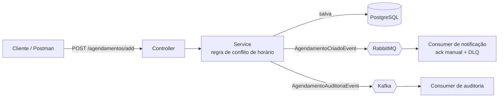

# AgendaFácil

[](https://github.com/GeovannaMLima/EasyAgenda/actions/workflows/maven.yml)

API de agendamento de serviços para profissionais autônomos (cabeleireiros, personal trainers, terapeutas). Profissionais cadastram os serviços que oferecem, clientes marcam horário, e o sistema **impede que dois agendamentos se sobreponham** para o mesmo profissional.

Projeto com mensageria **RabbitMQ** (notificação) e **Kafka** (auditoria). A aplicação e toda a infraestrutura rodam em containers, com Docker Compose.

## Stack

- Java 25 e Spring Boot 4 (Web, Data JPA, Validation)
- PostgreSQL
- RabbitMQ (Spring AMQP)
- Apache Kafka (Spring Kafka)
- Docker(build multi-stage) e Docker Compose
- JUnit 5 e Mockito
- GitHub Actions

## Como funciona

Ao criar um agendamento, o sistema valida os dados, verifica se o profissional já tem outro compromisso no mesmo intervalo, salva no banco e publica dois eventos: um para notificar o cliente e outro para registrar a auditoria.



### Entidades

- **Profissional:** quem presta o serviço.
- **Serviço:** o que o profissional oferece, com duração (em minutos) e preço. Pertence a um profissional.
- **Cliente:** quem marca o horário.
- **Agendamento:** um compromisso marcado, ligando cliente, profissional e serviço a uma data e hora de início. O horário de término é calculado a partir da duração do serviço.

### Regra de conflito de horário

Dois intervalos se sobrepõem quando o novo começa antes do fim do existente **e** o existente começa antes do fim do novo. Se houver sobreposição para o mesmo profissional, o agendamento é recusado e nada é salvo nem publicado.

## Decisões de arquitetura

### RabbitMQ para a notificação
A notificação é uma tarefa pontual: um agendamento foi criado, avisa o cliente, confirma e acabou. O RabbitMQ entrega isso com confirmação por mensagem. O consumer usa **ack manual**: só confirma depois de processar com sucesso. Se o processamento falha, a mensagem é rejeitada sem reenfileirar e vai para a **Dead Letter Queue** (`agendamento.criado.dlq`), em vez de se perder ou travar a fila.

### Kafka para a auditoria
A auditoria é um histórico: o que aconteceu precisa ficar registrado e não pode sumir depois de lido. O Kafka guarda os eventos em um log, que outros sistemas poderiam ler no futuro (relatórios, por exemplo), cada um no seu ritmo e com seu próprio consumer group.

### `profissionalId` é a chave da mensagem no Kafka
A chave decide a partição. Com o `profissionalId`, todos os eventos de um mesmo profissional ficam na mesma partição, e a ordem é garantida dentro dela. Por exemplo, "criado" nunca aparece depois de um "cancelado" do mesmo agendamento.

### Kafka com dois listeners
Quando um cliente se conecta ao Kafka, ele recebe de volta o endereço pelo qual deve falar 
com o broker (Advertised Listener), e esse endereço depende de quem está perguntando. A aplicação 
rodando no IDE, fora do Docker, acessa por ```localhost:9092```. Já a aplicação rodando em container precisa
do nome do serviço na rede do Compose, ```kafka:19092```, porque localhost dentro do container seria ele mesmo. Por isso o broker expõe dois listeners (EXTERNAL na porta 9092 e INTERNAL na 19092), além do CONTROLLER, de uso interno do Kafka. Assim, o mesmo Compose permite rodar a aplicação das duas formas.

> Este é um projeto de estudo e usa os dois brokers de propósito, para comparar na prática. Em um sistema real, eu avaliaria se os dois são necessários ou se um deles resolve.

## Como rodar

### Pré-requisitos

- JDK (versão definida no `pom.xml`),apenas para rodar aplicacao fora do docker (opção 2)
- Docker e Docker Compose

### Configuração (valido para as duas opções)

1. Clone o repositório:
   ```bash
   git clone <url-do-repositorio>
   cd <pasta-do-projeto>
   ```
2. Crie o arquivo de variáveis a partir do exemplo e preencha a senha:
   ```bash
   cp .env.example .env
   ```
   No PowerShell, use ```copy .env.example .env.```

### Opção 1: Docker
3. Suba a infraestrutura (PostgreSQL, RabbitMQ , Kafka e API):
   ```bash
   docker compose up -d --build
   ```
### Opção 2: Aplicação IDE (desenvolvimento)
3. Suba a infraestrutura e rode a aplicação localmente:
   ```bash
   docker compose up -d postgres rabbitmq kafka
   ./mvnw spring-boot:run
   ```

A API fica em `http://localhost:8080`. O painel do RabbitMQ fica em `http://localhost:15672` (usuário e senha `guest`).

## Endpoints

Cadastre nesta ordem, porque o agendamento depende dos três primeiros.

### 1. Profissional
`POST /profissional/register`
```json
{ "nome": "Maria", "email": "maria@email.com" }
```

### 2. Serviço
`POST /servico/add`
```json
{ "nome": "Corte de cabelo", "duracao": 60, "price": 50.00, "profissionalId": 1 }
```

### 3. Cliente
`POST /cliente/register`
```json
{ "nome": "Ana", "email": "ana@email.com", "telefone": "999999999" }
```

### 4. Agendamento
`POST /agendamentos/add`
```json
{ "clienteId": 1, "profissionalId": 1, "servicoId": 1, "dataHoraInicio": "2026-12-10T14:00:00" }
```

Resposta (`201 Created`):
```json
{
  "id": 1,
  "nomeCliente": "Ana",
  "nomeProfissional": "Maria",
  "nomeServico": "Corte de cabelo",
  "dataHoraInicio": "2026-12-10T14:00:00",
  "dataHoraFim": "2026-12-10T15:00:00"
}
```

A data precisa estar no futuro. Um segundo agendamento no mesmo horário para o mesmo profissional é recusado.

## Testes

```bash
./mvnw test
```

`AgendamentoServiceTest` cobre a regra de negócio com Mockito, sem subir banco nem brokers:

- Cria o agendamento quando não há conflito e publica os dois eventos;
- Recusa quando há conflito e confirma que nada é salvo nem publicado.

## Integração contínua (CI)
- A cada push e a cada Pull Request, o GitHub Actions executa os testes automaticamente (workflow `Java CI with Maven`).
  
- O workflow `.github/workflows/maven.yml` roda em dois jobs:

1. **build**: a cada push e Pull Request, baixa o código, configura o JDK 25 e executa os testes (`mvn -B test`).
2. **docker**: só em push na `main` e somente se os testes passaram, faz login no Docker Hub e constrói e publica a imagem `geolima2/agendafacil`, com as tags `latest` e o SHA do commit. As credenciais ficam nos GitHub Secrets.

Para baixar a imagem publicada:

`docker pull geolima2/agendafacil:latest`